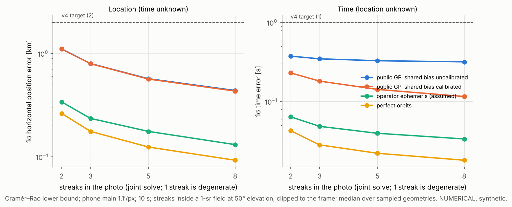
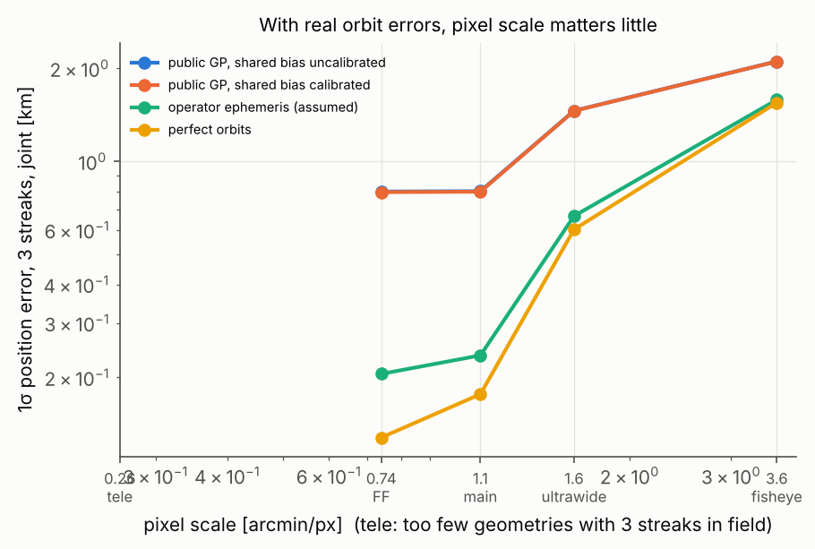
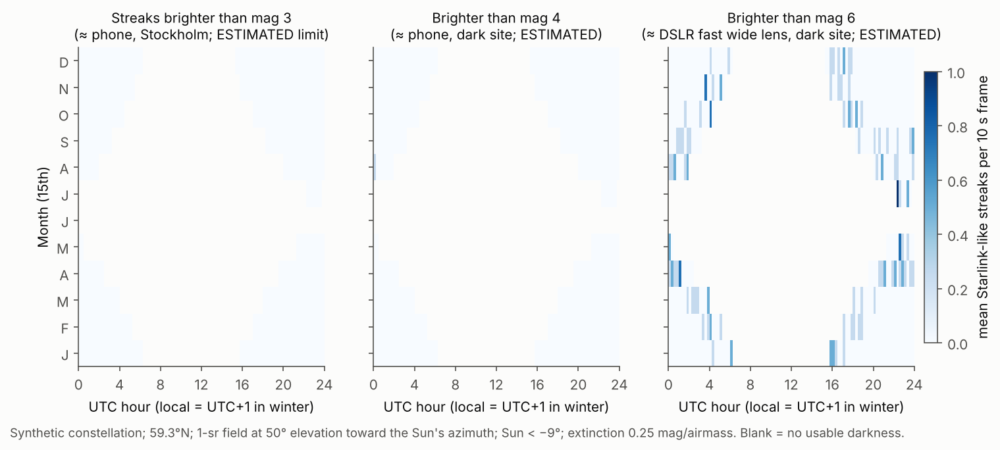

# Starlink sky-clock: feasibility study

Prepared 2026-11-10 for Vishvam. Research, simulation and an in-project AI review. **No outside person has reviewed this.** Every number is labelled **VERIFIED** (with the source and how far it was read) or **ESTIMATED** (with reasoning). Simulation code and figures are in [`sim/`](sim/) and [`figs/`](figs/). This version includes fixes from an adversarial review (see the review log at the end).

## TL;DR

1. **Novel? Partly.** Location-from-satellites-with-a-known-clock is patented (Lockheed [US8837782](https://patents.google.com/patent/US8837782), Draper [US10782134](https://patents.google.com/patent/US10782134)). Time-from-satellites-at-a-known-site is routine practice (Bill Gray's [GNSS timing method](https://projectpluto.com/gps_expl.htm)). Manual time/place matching with Starlink overlays is done on [Metabunk/Sitrec](https://www.metabunk.org/sitrec/docs/Starlink.html). In the sources that loaded, I found no **automatic, blind, joint (t, φ, λ) solve with uncertainty** from a consumer image. Most of the search connectors you listed (alphaXiv, Solve Intelligence, Exa, Consensus, Scite, TubeAlfred, vidIQ) did not load, so this is not a novelty claim.
2. **Feasible? The geometry works, but the photons mostly don't.** One streak cannot do a joint solve (it is degenerate, about 60 km and 7 s). With ≥2 streaks on different tracks, the Cramér–Rao *lower* bound for a phone main camera with fresh public elements is about **1.1 km and 0.2–0.4 s**. With 3 streaks it is about **0.8 km and 0.2–0.35 s** (NUMERICAL, synthetic). The problems: a typical Starlink V2 Mini is about **mag 7** ([Mallama 2023](https://arxiv.org/abs/2306.06657)), and a phone streak needs about mag ≤3–4 (ESTIMATED). My model therefore predicts **essentially zero ordinary Starlink streaks per phone frame**. A regular constellation also creates **aliases**: other (time, longitude) pairs that fit all the streaks.
3. **Best realistic accuracy:** about **0.5–1 km and about 0.3 s** with 3–8 streaks and fresh public elements. The ~0.3 s is a time floor from the **shared** TLE along-track bias, which more streaks don't average away. It drops to about 0.12–0.18 s only if you calibrate that bias. Orbit errors, not pixels, set the floor. Operator-derived ephemerides could reach about 0.2 km and 0.04 s (ESTIMATED; their Starlink accuracy is unverified).
4. **Who it's for:** OSINT/forensic **consistency checking** (does this photo match its claimed time and place?), meteor and all-sky networks with bad clocks, and science communication. Blind location recovery from strangers' photos is the weakest use case and the most ethically risky one.
5. **Go/no-go: GO, re-scoped.** Build it as a consistency checker plus a blind solver for tripod, manual-exposure and DSLR/all-sky images, using all bright LEO objects and not only Starlink. **Don't build "any phone, any photo".** Run the three tests in the final section this week before writing pipeline code.

---

## Step 0: Tools, skills and accounts

### 0.1 What was available in this session

| Tool | Status | Coverage lost |
|---|---|---|
| alphaXiv | **Installed, sign-in incomplete**: not usable | arXiv full-text search. I used web search plus direct arXiv abstract pages instead. |
| Solve Intelligence | **Sign-in incomplete** | Patent full-text and prior-art search. I read Google Patents pages directly, but **CN/EP/JP patents were not searched**. |
| Exa | **Not connected (needs auth)** | Code/doc search. I used the GitHub REST search API (`gh api search/repositories`) instead, which covers repo names and descriptions only, not code. |
| Consensus, Scite | **Sign-in incomplete** | Citation cross-checks. Citing papers were **not** checked. |
| vidIQ, Higgsfield, ElevenLabs | **Not installed** | YouTube analytics and video/voice generation. |
| TubeAlfred YouTube plugin | **Failed to connect** (proxy 403) | YouTube transcripts and keyword data. The video landscape check rests on web search only. |
| github plugin | **Failed to connect** (proxy 403) | Partly replaced by `gh api`. |
| Data plugin MCP servers | Failed to connect | Not needed: analysis ran in local Python. |
| Google Drive | Connected | Not used. Say if you want the report there. |
| Web search, page reading, Python (numpy/scipy/skyfield 1.55/sgp4 2.27) | Working | n/a |
| research-integrity, dataviz skills | Loaded and followed | n/a |
| research-superpowers brainstorming / writing-research-plan / literature-review | **Not run as full workflows.** They are built around a project wiki and BibTeX tree, and their scout targets humanities databases. | The research plan in section 7 follows their structure (falsifiable hypothesis, tasks, pass/fail criteria). |
| requesting-peer-review (adversarial) | Run as a separate AI reviewer session. See "Review log" at the end. | n/a |
| **Network**: CelesTrak, Space-Track, JPL and astrometry.net data hosts were **blocked** from this sandbox | | **No real element sets were used.** All simulations use a synthetic Starlink-like constellation. This is the biggest coverage loss. |

**Connect checklist** (claude.ai → Settings → Connectors). Finish sign-in for **alphaXiv, Solve Intelligence, Consensus, Scite** (each shows "connect incomplete"). Connect **Exa**. For TubeAlfred and github, the plugins are installed but failed to connect from this cloud environment's network; reconnect them or run them from a local session. After that, ask me to re-run section 1 against those tools.

### 0.2 Accounts: your sign-up checklist (I created none)

| # | Account | URL | Unlocks | When |
|---|---|---|---|---|
| 1 | **Space-Track.org** (free; personal user agreement) | https://www.space-track.org/auth/createAccount | Full GP catalogue, including non-Starlink bright objects; **GP history** for old photos ("over 138 million historical elsets", per its FAQ, VERIFIED read-directly). | **Now** if you want old photos or non-Starlink objects. Otherwise later. |
| 2 | **nova.astrometry.net** (optional) | https://nova.astrometry.net → sign in → "API" page for the key | Online plate solving. | **Optional.** Local `astrometry.net` with the **4100-series** wide-field indexes (≈ 4110–4119 for 20–120° fields) is better: offline, no upload of your photos, and no rate limits. ASTAP is an alternative. |
| 3 | SpaceX space-safety portal | https://docs.space-safety.starlink.com | Starlink operator ephemerides, uploaded "roughly every 60 minutes, with a 7 day time horizon" (VERIFIED read-directly). | **Later.** Public access is unclear: the docs talk about "users" of an operator screening system. CelesTrak's **SupGP** already derives from SpaceX's public ephemerides and needs no account. |

Not needed: CelesTrak (no account). Paste keys into a local `.env` that git ignores. I will never print one back in full.

**Space-Track rules to respect** (VERIFIED, partly read directly and partly from a summary): fewer than 30 requests per minute and 300 per hour; GP at most once per hour; **GP_HISTORY "1 / lifetime"** per object, so store it locally. The user agreement restricts transferring data to third parties without approval, while another section gives blanket approval for "basic SSA data" if it is cited. The two may conflict, so **don't publish raw Space-Track elements from a public web tool** until you've read the full agreement.

---

## 1. Novelty audit

### Closest prior work

| Work | What it does | Known time? | Known site? | Gap vs your idea |
|---|---|---|---|---|
| **US8837782** "Geoposition determination using satellite ephemerides" (Lockheed, priority 2010, Google lists it active to 2031) [link](https://patents.google.com/patent/US8837782) | Observer lat/lon from images of a satellite plus ≥2 stars. It handles along-track ephemeris error **by combining ≥2 satellites and using cross-track information**. That is your degeneracy-breaking idea. | **Yes** (time t₀ is an input; timing error is a nuisance) | Solved | No time solve. Telescope on a stabilised mount, not a consumer camera. Its two-satellite trick handles along-track *ephemeris* error, which is related to but distinct from the time/along-track geometric degeneracy. *Read: description read directly; claims only as a summary.* |
| **US10782134** "Ephemerides-free celestial navigation" (Draper, priority 2017, active to 2039) [link](https://patents.google.com/patent/US10782134) | Observer position from the curvature of satellite tracks against stars, **without ephemerides**. | **Yes** ("given … times of observation") | Solved | No time solve. *Claim 1 read verbatim.* |
| **US7526381** NATTS (Terahop, 2009) [link](https://uspto.report/patent/grant/7526381) | Device location from a sky photo matched to a star map. | Yes (device clock) | Solved | Stars only. *Read to about 60%; rest as a summary.* |
| Bill Gray, [GNSS timing calibration](https://projectpluto.com/gps_expl.htm); [Birtwhistle how-to](https://birtwhistle.org.uk/MethodsCheckTiming.htm) | Image **time error** from the along-track offset of GNSS satellites. Birtwhistle reports −0.005 ± 0.038 s. | Solved | **Yes** (MPC coordinates) | This is your case (b), already done precisely with better orbits. |
| Metabunk / **Sitrec** ([locating a video](https://www.metabunk.org/threads/example-of-using-sitrec-to-locate-a-video.13975/), [Starlink flares](https://www.metabunk.org/sitrec/docs/Starlink.html)) | **Manual** matching of camera location, and of time ("adjust the millisecond value"), until aircraft, stars or Starlink overlays line up. About 0.25 mi achieved with aircraft. | Manual | Manual | No optimiser, no posterior, no blind search. **The closest thing to your pitch in practice.** |
| IDSat / Findsat ([Metabunk 2015](https://www.metabunk.org/threads/identifying-satellites.5769/latest)) | Identify a satellite from position + time + site. One user notes a camera clock was probably wrong. | Input | Input | Identification only. |
| [SatStreak](https://github.com/kaloyanstefanov66/SatStreak), [Argus](https://github.com/robertmwolf/Argus), [Bingeeverything/satellite-tracker](https://github.com/Bingeeverything/satellite-tracker) (last one did not load) | Identify satellites in photos, including phone astrophotography. Time and site come from EXIF. | EXIF | EXIF | **Yes: tools that identify satellites in consumer photos already exist** (early-stage, 0 stars). |
| [stvid](https://github.com/cbassa/stvid) (Cees Bassa) | Video satellite astrometry → IOD format. | NTP | Config | Known time and site. |
| Halferty et al. 2022, [arXiv:2208.03226](https://arxiv.org/abs/2208.03226) | Measured Starlink TLE error with a timed camera: **0.3 s mean along-track (σ 0.28 s)**. | Known | Known | This is your accuracy floor, measured. |
| Passmore 2026, [engrXiv 8756](https://engrxiv.org/preprint/view/8756) | Joint **clock offset** + dish pointing from Starlink/OneWeb radio passes; τ = 0.007 ± 0.026 s. | Solved | Known | Radio, known site. *Abstract only.* |
| Project Luciole, [Vida et al. AMOS 2024](https://amostech.com/TechnicalPapers/2024/Poster/Vida.pdf) | Meteor-style cameras tracking LEO. Reports **satellites offset up to 2 s from catalogue TLEs**. | GPS | Known | Independent evidence of the TLE floor. |

### Verdict: **partly novel**

What is genuinely new (within the searched reach):

1. Solving time and location **jointly and blindly** (no EXIF, date known roughly) from one image. That requires a **satellite-identity search** over about 11,000 Starlink satellites plus other objects.
2. Explicit handling of **constellation aliasing** (Walker symmetry, section 3.4). I did not find it in this limited search (abstracts and US patents only).
3. A **posterior** (probability map plus time distribution) rather than a best manual fit.
4. Framing it as a **consistency test** for OSINT.

Not new: the physics, the two-satellite trick for breaking along-track error (Lockheed), time-from-satellites (Gray), satellite ID in phone photos (SatStreak et al.), and manual Starlink time/place matching (Sitrec).

### Search log (research-integrity)

| Query / source | Opened | Blocked / not done |
|---|---|---|
| Web: "determine observer location and time from satellite streaks…" | DTIC streak detection, GaTech IOD (abstract), SatStreak | n/a |
| Web: arXiv satellite streak astrometry geolocation timing Starlink | 2208.03226 (full), 2603.10790 (title only), engrXiv 8756 (abstract) | arXiv full text via alphaXiv: **blocked** (connector) |
| Google Patents US8837782, US10782134; uspto.report 7526381 | Read (see table) | **Solve Intelligence blocked**; CN/EP/JP not searched; US8837782 claims summary-only |
| GitHub REST search: "satellite streak identification/detection", "stvid", "geolocate photo stars" | Repo descriptions + 4 READMEs | Code search not run; 1 README rate-limited; github plugin and Exa blocked |
| Metabunk/Sitrec, Bellingcat toolkit (OrbTrack), EBU/GIJN chronolocation guides (titles) | Metabunk threads, Sitrec docs, OrbTrack | Sitrec2 docs and metabunk.org/sitrec were robots-blocked; SeeSat-L archives **not searched** |
| YouTube landscape | Web search only | **TubeAlfred and vidIQ blocked**: no transcript or keyword data |
| Consensus / Scite citation checks | n/a | **Blocked**: no forward-citation sweep on Halferty or the patents |
| ADS / Google Scholar | **Not searched** (no connector) | n/a |
| Stopped: **yes**, for patents (non-US) and citations | | |

**Novelty sentence:** "Searches of Google Patents (US only), web, arXiv abstract pages, GitHub repository metadata and Metabunk found no automatic blind joint time+location solver for consumer sky images. alphaXiv full text, Solve Intelligence, Consensus, Scite, ADS, SeeSat-L archives, YouTube transcripts and non-US patents were not searched." This does not claim the method is first.

---

## 2. Data sources

| Source | Access / format | Cadence & latency | History | Licence / ToS | Accuracy for this use |
|---|---|---|---|---|---|
| **CelesTrak GP** (`gp.php?GROUP=starlink`) | No account; TLE (only for catalogue numbers < 100000), OMM XML/KVN/JSON/CSV. **New Starlink numbers are > 100000 soon, so use OMM/JSON, not TLE.** | CelesTrak checks for new GP "once every 2 hours"; 18 SDS data "only updates 2-3 times a day" (VERIFIED read-directly). Rate rule: more than 100 HTTP errors in 2 h gets you blocked. | Current only; the [archive page](https://celestrak.org/NORAD/archives/) covers legacy sets 1980–2004 and "Special Data Request" | Free; attribution expected | Halferty: 0.3 s along-track mean, σ 0.28 s, 3σ 1.2 s (VERIFIED read-directly, 2022 version). Jankovic 2026: median position error ~1 km at 6 h age, growing to ~38 km at 7 d (VERIFIED, **abstract only**) |
| **CelesTrak SupGP Starlink** | No account; same formats | Derived "from latest Starlink ephemeris data from SpaceX's public data repository" (VERIFIED read-directly) | Current | Free | **No Starlink accuracy number published.** For GPS, SupGP is about 0.87 km vs 7.54 km for GP (VERIFIED). Starlink improvement: ESTIMATED to be similar, **unverified**. This is the first thing to measure. |
| **Space-Track GP / GP_HISTORY** | Free account | GP hourly; history once per object per lifetime | Starlink back to 2019 launch (ESTIMATED; depth not stated on the page) | Redistribution restricted (see Step 0) | Same as GP |
| **SpaceX operator ephemerides** | Space-safety portal (CCSDS OEM, KVN, covariance optional) | About hourly, 7-day horizon (VERIFIED) | Unknown | Unclear | Probably best (they include planned manoeuvres). ESTIMATED; no accuracy stated. |
| Old photos | GP_HISTORY: pick the element set with epoch just **before** the photo (and after, to bracket manoeuvres) | n/a | n/a | n/a | Usable for Starlink since 2019. Error grows quickly with element age, so old photos only resolve to several km and seconds unless SupGP was archived. |
| Stars: astrometry.net 4100-series ([readme](https://astrometry.net/doc/readme.html#getting-index-files)); Gaia via astroquery for refinement | Local | n/a | n/a | BSD / Gaia CC-BY | Plate solution ≪ 0.1 px over hundreds of stars; not the limiting term |
| Libraries | skyfield **1.55** (2026-08-07), sgp4 **2.27** (2026-07-03), astropy **8.0.2** (2026-10-15). VERIFIED from PyPI. | | | | |
| **Constellation size** | **11,204 Starlink in orbit on 2026-11-09** ([KeepTrack](https://keeptrack.space/starlink-satellite-count), third-party). About 4,400 were moved from ~550 to ~480 km during 2026 ([The Register](https://www.theregister.com/2026/01/02/starlink_lower_orbits/)). | | | | Your "ρ ≈ 550 km" is now **≈ 480 km** for half the fleet |
| Ground truth for test photos | Time: photograph a phone showing [time.is](https://time.is) (NTP-synced, ±50 ms) in frame before and after each sequence, plus a GPS-time app. Location: phone GNSS fix (±5–10 m) screenshot, cross-checked on a map. | | | | Far better than needed |

**Better-than-TLE free options:** (1) CelesTrak SupGP; (2) for non-Starlink, **GNSS satellites** have cm-level public ephemerides (IGS precise orbits) but sit at 20,000 km, so parallax per km is about 40× smaller. They are a superb clock (Gray) and a weak locator. (3) ILRS laser-ranging targets (CPF predictions, metre-level) are few, but excellent as **calibration** streaks.

---

## 3. Feasibility (simulation-first)

All results are **NUMERICAL** from [`sim/skyclock_v2.py`](sim/skyclock_v2.py) (constellation helpers in `sim/skyclock_sim.py`), run on a **synthetic** 10,716-satellite Walker stand-in for Starlink (7 shells with approximate inclinations and altitudes; not fitted to real elements). They show how errors scale. They are not predictions for a real night.

### 3.1 Your numbers, checked

| Claim | Check | Status |
|---|---|---|
| 1 km observer shift ≈ 6′ at ρ = 550 km | 1/550 rad = **6.25′**. At ρ = 480 km it is 7.2′; at 30° elevation (ρ ≈ 900 km) it is **3.8′**. | ESTIMATED (geometry); correct |
| Phone main camera ≈ 1′/px | 24 mm-equivalent → 73.7° horizontal FOV. At 4000 px (12 MP binned) that is **1.1′/px**; at 8000 px (50 MP) 0.55′/px but noisier. Ultrawide (13 mm-eq, 108°) ≈ **1.6′/px**. 5× tele (120 mm-eq, 17°) ≈ **0.26′/px**. | ESTIMATED (typical specs; per-model spec pages not read) |
| LEO near zenith moves ~0.8°/s | v = √(μ/a) = 7.62 km/s at 480 km → 7.62/480 rad/s = **0.91°/s** | ESTIMATED; correct |
| Along-track TLE error "of order seconds" | Halferty: **0.3 s mean, σ 0.28 s**, 3σ 1.2 s; Luciole: up to 2 s outliers | VERIFIED for **2020–22 data on the older fleet at ~550 km**. Not re-measured for the 2026 fleet at 480 km, where drag is higher. Note that the 0.3 s is a **mean (shared) lag**. |

### 3.2 Model

For streak $i$ with exposure start $t_0$, length $T$ and fraction $f\in[0,1]$ along the streak:

$$\hat u_i(f)=\frac{\mathbf r_i\big(t_0+f(T+\delta T)+b+\delta t_i\big)+c_i\hat h_i+r_i\hat r_i-\mathbf r_{\rm obs}\big(\varphi,\lambda,h,\;t_0+f(T+\delta T)\big)}{|\cdots|}$$

The observer co-rotates with the Earth, so $(\varphi,\lambda)$ offsets are geographic. Measurements: the **cross-track** offset of every PSF-length sample along the streak that lies **inside the field of view** (σ = 0.3 px, ESTIMATED), plus the **along-track** position of each endpoint, only if that endpoint is inside the frame (σ = 1 px, ESTIMATED).

Nuisances:
- **Shared** along-track orbit bias $b$, common to all satellites and exactly degenerate with $t_0$.
- Per-satellite along-track $\delta t_i$, cross-track $c_i$ and radial $r_i$.
- Per-streak distortion residual: offset plus tilt/bow, σ = 0.3 px each.
- Exposure-length error δT (σ = 0.05 s).

All have Gaussian priors and are marginalised in $F=J^\top WJ+\Lambda_{\rm prior}$. The covariance comes from an explicit inverse with a condition-number guard.

Geometries: 25 random draws with N satellites inside the camera's field (a cone of the same solid angle), pointed at **50° elevation toward the Sun's azimuth**, 1.5 h after a January sunset.

Orbit-error scenarios (1σ; shared / per-satellite along-track, cross-track, radial):

| Scenario | Shared | Per-satellite | Cross | Radial | Basis |
|---|---|---|---|---|---|
| Public GP, bias uncalibrated | 0.30 s | 0.28 s | 0.5 km | 0.2 km | Along: Halferty mean and σ. Cross/radial: ESTIMATED |
| Public GP, bias calibrated | 0.05 s | 0.28 s | 0.5 km | 0.2 km | Assumes you measure the current mean lag yourself |
| Operator ephemeris | 0.02 s | 0.05 s | 0.1 km | 0.05 km | ESTIMATED, unverified |
| Perfect | ~0 | ~0 | ~0 | ~0 | Finite tiny priors |

Not modelled (so these are **lower bounds**): rolling shutter, plate-solution attitude error, J2 and drag over the exposure, satellite misidentification, manoeuvres.

### 3.3 Results

Phone main camera, 1.1′/px, 10 s exposure; median over the geometries (numbers copied from `figs/v2_control_crb_census.json`, rounded):

| Case | 1 streak | 2 streaks | 3 | 5 | 8 |
|---|---|---|---|---|---|
| (a) time known → position, GP uncalibrated | 3.5 km | 1.1 | 0.80 | 0.57 | 0.44 |
| (b) site known → time, GP uncalibrated | 0.42 s | 0.36 | 0.34 | 0.33 | 0.31 |
| (b) site known → time, GP calibrated | 0.29 s | 0.21 | 0.17 | 0.14 | 0.11 |
| **(c) joint, GP uncalibrated**: position / time | **58 km / 7.1 s** (degenerate) | 1.1 km / 0.38 s | 0.80 / 0.35 | 0.57 / 0.33 | 0.44 / 0.32 |
| (c) joint, GP calibrated | 58 / 7.1 | 1.1 / 0.23 | 0.80 / 0.18 | 0.57 / 0.14 | 0.43 / 0.12 |
| (c) joint, operator ephemeris | 58 / 7.1 | 0.34 / 0.064 | 0.24 / 0.049 | 0.18 / 0.040 | 0.13 / 0.034 |
| (c) joint, perfect orbits | 58 / 7.1 | 0.26 / 0.043 | 0.18 / 0.028 | 0.13 / 0.022 | 0.093 / 0.018 |

What this shows:

- **One streak cannot do the joint solve, even with perfect orbits.** The degeneracy is geometric: moving the observer along the ground track of the satellite looks almost the same as a small time shift. The streak's rate and curvature break it only very weakly. **Two streaks on different tracks fix it.** (This corrects my first draft, which claimed 0.07 km for one streak. That number was an artefact of a pseudo-inverse.)
- **Time has a floor of about 0.3 s** unless you calibrate the shared TLE lag. More streaks don't help, because the bias is common to all of them. Calibration is cheap: v2 below measures it on your own photos at a known time and place.
- **Position** improves roughly as σ_cross/√N and reaches about 0.4–0.8 km with 3–8 streaks.
- **Pixel scale matters little between 0.7 and 1.6′/px** once orbits are imperfect: 3 streaks give 0.80 km on the DSLR, 0.80 on the phone main and 1.46 on the ultrawide. The all-sky fisheye (3.6′/px) gives about 2.1 km with 3 streaks and 0.77 km with 8. The **5× tele almost never has 3 satellites in its 0.07 sr field** (0 of 25 draws).

Mitigations, ranked:
1. **Calibrate the shared lag** with known-time frames (removes the 0.3 s floor).
2. **SupGP / operator ephemerides** (about 3× better if the assumed numbers hold).
3. **Element sets less than 12 h old**.
4. **More streaks or frames** (√N on position).
5. **Non-Starlink calibration objects** with better orbits (ILRS targets; GNSS for the clock).

### 3.4 The aliasing problem (not in your brief)

Starlink shells are near-**Walker patterns**. Advance time by one in-plane spacing $P/S$ (≈ 257 s for a 22-satellite plane at 480 km), and every satellite in that shell moves into its predecessor's slot. An observer at the same latitude, shifted in longitude by $-\omega_\oplus\Delta t$, keeps the **same inertial position**, so **the stars are identical and that shell's satellites are too**. Plate-solved stars give no information about time or place without a horizon.

I tested this with [`alias_scan`](sim/skyclock_v2.py): a 1 s coarse grid over ±90 min, continuous refinement at 0.02 s around every candidate, and a match when all 3 streaks lie within 3′ of some satellite.

| Test | Result |
|---|---|
| **Control:** 3 streaks all from one perfect shell | Aliases found at exactly ±256.92 s and ±513.84 s, with a worst miss of 0.004′. The scan finds the aliases it should. |
| 12 random 3-streak geometries from the full 7-shell synthetic constellation (59.3°N, elevation > 30°); slot scatter 0, 1, 3 or 10 km | **0 aliases in every case.** In all 12 geometries the streaks came from ≥ 2 different shells. |

So aliasing is a real problem **when all the streaks come from one shell**: a fresh train, a single-shell-dominated sky, or an observer latitude where one shell dominates. Then only real slot scatter (unknown; ≳ 1 km would push the mismatch above 3′) or extra clocks break it. With mixed shells it disappeared in this synthetic test. The scan covers **only** the same-latitude symmetry line, two-body orbits, and a synthetic shell layout. Real behaviour is **untested** (highest-risk assumption #2).

### 3.5 Expected streaks per photo, Stockholm (59.3°N)

Model (all ESTIMATED except where marked):
- $m = 7.87 + 5\log_{10}(\rho/1000\,{\rm km}) + 0.25X + \mathcal N(0,1)$, where 7.87 is the brightness-mitigated V2 Mini mean at 1000 km (VERIFIED abstract-only, [Mallama 2023](https://arxiv.org/abs/2306.06657)) and $X$ is airmass.
- This is applied to **every** shell, which probably makes older-generation satellites too faint. It has **no phase-angle dependence**, so it misses twilight brightening ([Mallama 2024](https://arxiv.org/abs/2401.01546): the largest bright areas "occur during twilight").
- Counts are streaks that enter a **1-sr field at 50° elevation toward the Sun's azimuth** during a 10 s exposure, sunlit (cylindrical shadow), with Sun < −9°.

- **Mid-May to late July: no dark window.** The Sun's lowest point at the solstice is −7.3° (90 − 59.3 − 23.44; ESTIMATED geometry).
- **Winter:** satellites are sunlit only for about **2–3 h after dusk and before dawn**.
- **Phone (streak limit mag 3–4): essentially 0 Starlink-like streaks per frame in every month.**
- **DSLR with a fast wide lens at a dark site (limit about mag 6):** at most about **0.5–1 per frame** in the twilight bands. With mag 7, up to about 2.
- P(≥ 3 streaks) for a Poisson mean of 1 is 8%, so **a single-frame, ≥ 3-streak dataset is impractical**. Use multi-frame sequences and all bright objects.

**Streak limiting magnitude** (ESTIMATED, sky-limited). A streak deposits flux into each PSF element for $t_d = w/\dot\theta$ instead of $T$, while sky noise accumulates over all of $T$. A matched filter along $L/w = T/t_d$ elements recovers $\sqrt{L/w}$:

$$\Delta m \approx 2.5\log_{10}(T/t_d) - 1.25\log_{10}(L/w) = 1.25\log_{10}(T/t_d).$$

Phone main camera, 10 s, 1.1′/px, 0.9°/s, w = 2 px: $T/t_d\approx 245$, so **Δm ≈ 3.0 mag**. A phone reaching mag ~5–6 stars in 10 s from Stockholm (ESTIMATED) therefore records streaks only to about **mag 2–3**, and to about mag 4 from a dark site.

**Typical V2 Minis (measured mean apparent mag 7.06) are invisible to phones.** Phones can catch:
- fresh launch trains and orbit-raising satellites,
- Direct-to-Cell satellites (mean **5.16**, VERIFIED abstract-only, [arXiv:2502.03651](https://arxiv.org/abs/2502.03651)), but only from a dark site and borderline,
- flares, the ISS, and bright rocket bodies and older satellites.

**Consequence:** use **all catalogued bright objects** (Space-Track full catalogue), not just Starlink.

**Where the method breaks:**
- handheld or night-mode phone in a city,
- fewer than 2 streaks per solve,
- streaks clipped at both ends,
- stacked frames with unknown gaps,
- all streaks from one shell (aliases),
- a manoeuvre between the element epoch and the photo.

---

## 4. Devices: who can actually do this?

| Device | Works? | Expected accuracy (≥ 2 streaks, GP) | Why |
|---|---|---|---|
| Budget Android, auto mode | **No** | n/a | Short auto exposures, heavy noise reduction, JPEG smoothing; streak limit ≲ mag 2 |
| Flagship Android, astro mode (Pixel) | **Unreliable** | ~1–3 km if ≥ 2 bright streaks survive | Pixel stacks ≤ 15 frames × ≤ 16 s, "aligned … and then averaged" ([Google 2019](https://research.google/blog/astrophotography-with-night-sight-on-pixel-phones/), read directly). The post does **not** say moving objects are rejected. Expect **dashed or faint streaks with unknown inter-frame gaps**. Untested. |
| iPhone Night mode | **Unknown** | n/a | No authoritative source found on whether it is one exposure or a stack (forum opinion only). Must test. |
| Phone + manual long-exposure app (Open Camera, ProCam, Halide RAW), tripod | **Only with bright non-Starlink objects or trains; unproven** | ~1 km / 0.3 s *if* ≥ 2 streaks | One continuous exposure (5–15 s); RAW avoids JPEG smoothing. Model predicts ~0 ordinary Starlink streaks (limit mag 2–4). **Test #1 below decides this.** |
| Phone **video** | **Only for very bright objects** (ISS, trains, flares) | Time to ≪ 0.1 s for those | Per-frame 1/30 s pushes the limit to about mag 1–2 (ESTIMATED). Relative frame timing is good but variable frame rate must be read from container timestamps; rolling-shutter skew (~10–30 ms readout) shifts points by up to ~1.6′. |
| Action cam (night/timelapse) | Marginal | ~2 km | Fisheye distortion, small aperture |
| **DSLR/mirrorless + 14–24 mm f/1.4–2.8, tripod, RAW** | **Probably**: the reference instrument | **0.8–1.1 km / 0.2–0.4 s** with 2–3 streaks (GP) | Streak limit about mag 5–6 from a dark site; about 0.5–1 Starlink-like streak per frame in twilight bands (model), more with all bright objects |
| **Meteor / all-sky camera** (GMN-style) | **Yes, best use case** | ~0.8–1 km with 5–8 streaks; clock offset ~0.3 s per frame (TLE-lag limited), better once the lag is calibrated | Huge FOV, continuous video. The site is known, so the useful product is **clock checking**. |

**Concrete settings (ESTIMATED):** 5–15 s exposure (longer smears stars on a 24 mm lens beyond ~15 s; 500-rule ≈ 20 s), ISO 1600–3200 (phone: maximum native), main lens, focus at infinity, tripod mandatory, RAW. **Plate solve:** ≥ 10–20 stars detected (astrometry.net needs about 4–5 for a quad hash, but more for robust distortion fitting). **Joint solve:** ≥ 2 streaks on **non-parallel** tracks, ideally ≥ 3. **Moon:** a bright Moon above the horizon costs about 1–2 magnitudes of depth (ESTIMATED). **Stockholm light pollution:** costs about 2 magnitudes versus a Bortle 3 site (ESTIMATED).

**Verdict on "anyone, any device": No.** Realistic users are people with a **DSLR or all-sky/meteor camera** shooting in twilight windows, and tripod phone users only when bright objects (trains, ISS, rocket bodies, flares) cross the frame. A random handheld or night-mode phone photo will almost never contain two identifiable streaks.

### Shooting protocol (validation dataset)

1. **Planning:** use Heavens-Above or your own predictor to choose windows 60–150 min after dusk (or before dawn), Sun < −9°, Moon down or < 30% illuminated. Note expected bright passes, train launches and DTC satellites.
2. **Sites:** ≥ 3: Stockholm centre, suburb (Bortle ~5), dark site (Bortle ≤ 3). Record a GNSS fix screenshot at each (± 10 m), and photograph the phone screen showing it.
3. **Time ground truth:** at the start and end of each sequence, photograph a second phone showing **time.is** (NTP, milliseconds) with the camera under test. Also record the camera clock offset (EXIF time vs time.is). For video, film the time.is screen for 5 s.
4. **Per site:** 30 frames × 10 s RAW on a tripod, main lens, pointed at about 50° elevation toward the twilight side (west after dusk, east before dawn). Then 10 frames with the ultrawide. Then 5 frames in the phone's **night/astro mode** (to test stacking). Then 60 s of video during a known bright pass.
5. **Lens calibration:** on one clear night, 10 frames of a dense star field at different positions in the frame (fits distortion against Gaia). Plus 5 checkerboard shots indoors at focus ∞ (optional).
6. **Metadata log** (spreadsheet): frame ID, device, lens, exposure, ISO, mode, site, cloud cover, Moon, notes. **Keep the EXIF**: the solver ignores it, but it's your truth.
7. **Target:** 20 *solves* with ≥ 2 streaks each, across ≥ 3 sites. A solve may combine **consecutive frames** of one sequence: use an intervalometer with a fixed gap, so inter-frame timing is known and one t₀ covers the sequence. At the modelled rates (about 0.5–1 streak per DSLR frame) that is about 5–10 frames per solve, so **expect 4–8 nights with a DSLR**, fewer if you include all bright objects.

---

## 5. Usefulness

| User | Value (1–5) | Accuracy they need | Notes |
|---|---|---|---|
| OSINT / journalism verification of night footage | **4** | Consistency at ~10 km / ~1 min is often enough; claims are usually "this place, this hour" | **Consistency checking** is far more robust than blind recovery: no alias problem, no identity search, works with one streak. Sitrec already does this manually, so the value is automation plus a calibrated p-value. |
| Meteor / fireball networks, all-sky cams with bad clocks | **4** | 0.1 s or better for trajectories | Site is known, so this is case (b) with many streaks per night. GMN-style cams are GPS/NTP-disciplined already ([Vida 2024](https://amostech.com/TechnicalPapers/2024/Poster/Vida.pdf)). Value is in auditing older and amateur cameras. |
| Astronomers checking image timing | 2 | ms | Gray's GNSS method is better (cm orbits). Don't compete. |
| Satellite-pollution studies | 2 | n/a | Streak ID tools exist; your addition is minor |
| Crowdsourced SSA (reverse mode) | 3 | sub-arcsec astrometry, ms timing | Phones are too coarse; DSLR/all-sky cams with good clocks could contribute IOD-format data like stvid. Crowded field already. |
| Education / sci-comm | **5** | n/a | The parallax-plus-clock story is visual and genuinely cool |
| Forensics (claimed time/place) | 3 | Consistency | Same as OSINT, but courts need validated error rates. That needs the 20-photo dataset and more. |

**Consistency checking is more valuable and more robust: agreed.** It turns a global multimodal search into a likelihood ratio at one hypothesis, with one streak enough to reject many false claims. Ship it first.

**Ethics and safeguards:**
- Frame the tool as **verification of public-interest footage and your own photos**, with consenting contributors.
- The public tool does **consistency checking only**. Blind location solving stays offline or research-only.
- Output **coarse posteriors** (≥ 10 km contours) publicly.
- **Refuse** images that look like private, personal snapshots (people or homes in frame).
- Delete uploads by default, and don't log solved locations.
- Document the alias and false-positive rates so nobody over-trusts a fit.
- Honest limit: a horizon or skyline already leaks location more than satellites do. Your tool isn't the main privacy risk, but don't make it an easy one.

---

## 6. Extensions (value × feasibility; "done" flagged)

1. **Consistency checker** (high × high). Partly done manually in Sitrec. Automation is new.
2. **Use all bright LEO objects + rocket bodies + ISS** (high × high). Fixes the brightness problem. Needs Space-Track.
3. **Multi-frame / many photos per night** (high × high). √N on the clock; breaks aliases.
4. **Add other sky clocks**: horizon/landmark (latitude and LST), twilight gradient (Sun depression), Moon, star-trail rotation in long exposures (polar axis gives latitude). All known OSINT tricks (Bellingcat sun/shadow); combining them with satellites is new-ish.
5. **Aircraft via ADS-B** (medium × medium). Done manually on Metabunk with Sitrec (~0.25 mi). Very strong near cities.
6. **Edited/composited sky detection** (medium × medium). A streak inconsistent with any orbit is a red flag; a pasted sky has stars that don't match the claimed site and time.
7. **Flares** (medium × low). Sitrec models Starlink flares; timing is sharp but brightness modelling is hard.
8. **Reverse mode / orbit refinement** (low × medium). Done well by stvid and SeeSat-L; phones are too coarse.
9. **Web tool with probability map** (high for video/sci-comm × medium). Build last, consistency-only by default.

---

## 7. Build plan (pre-registered style)

**Primary hypothesis H1 (falsifiable):** with ≥ 2 identified streaks on non-parallel tracks (from one frame, or a sequence with known inter-frame timing) taken on a tripod with manual exposure, the joint solve recovers location within 2 km and time within 1 s in ≥ 70% of 20 validation solves. **H0:** median error > 5 km or > 3 s, or more than 30% of solves lock onto a wrong mode (alias or misidentification).

**Data structures:** `Frame{wcs, exposure_T?, streaks[]}`; `Streak{pixels, endpoints(2×2), endpoint_flags(clipped?), line_fit(ρ,θ,cov)}`; `Hypothesis{t0, φ, λ, h, sat_ids[], direction_flags[], nuisances}`; `Posterior{samples, logZ}`.
**Libraries:** numpy/scipy, skyfield + sgp4 (OMM via `sgp4.omm`), astropy, astrometry.net (local), photutils/scikit-image (Hough, RANSAC), emcee or dynesty (nested sampling gives evidence for alias comparison), KD-tree on sky positions for identity search.

| Stage | Steps | Pass metric | Early failure tests | **Kill criterion** | Time (solo) |
|---|---|---|---|---|---|
| **v0 simulator** | Extend `skyclock_sim.py`: real OMM elements, render PNGs with PSF, noise, sky gradient, lens distortion, clipped and dashed streaks; inject known (t, site) | Recovered parameters within CRB × 2 on 100 synthetic frames | Re-run the alias scan with **real** elements | Real constellation shows aliases within 3′ for ≥ 30% of 3-streak geometries **and** no extra clock removes them → pivot to consistency-only | 1–2 weeks |
| **v1 (weekend)** | Known place and time: star subtraction, Hough/RANSAC, plate solve, ID by predicted track | ≥ 80% of streaks matched to the right object | Run on 10 of your own frames first | < 50% matched after fixing the obvious bugs → detection/brightness problem; switch to DSLR | 2–4 days |
| **v2 time-only** | Site known; fit t₀ (+ T, direction flags) | \|Δt\| < 2 s on ≥ 80% of frames | Compare with Halferty's 0.3 s. **Measure the current shared TLE lag here**; it feeds v4. | Median \|Δt\| > 2 s with fresh elements → orbit floor worse than published; try SupGP | 3–5 days |
| **v3 location-only** | Time known; fit φ, λ | < 5 km on ≥ 80% | Single-streak frames should fail (control) | Median > 5 km with ≥ 2 streaks → cross-track orbit error too large | 3–5 days |
| **v4 blind joint** | Identity search (KD-tree hashing of streak pole + rate), then nested sampling; date prior ±1 day | Median < 2 km and < 1 s on 20 real frames, ≥ 3 sites | Truth must have the highest evidence; record the alias evidence ratio; flag single-shell streak sets; check for manoeuvres (element epochs before and after the photo disagree) | Truth not the top mode in > 30% of frames → ship consistency-checker only | 3–6 weeks |
| **v5 consistency checker** | p-value / likelihood ratio at a claimed (t, site) | Calibrated: false-reject rate ≈ nominal on true claims; rejects 1 h / 50 km false claims ≥ 90% | n/a | n/a | 1 week |

Total: about **2–3 months part-time** to v4 (ESTIMATED).

---

## 8. Video concept (10–15 min)

*Landscape check incomplete: TubeAlfred and vidIQ did not load. Web search found OSINT geolocation videos (sun/shadow chronolocation) and Sitrec Starlink case studies, but no video doing an automatic satellite time/place solve. That is not proof none exists.*

1. **Hook (0:00–0:45):** "This photo has no metadata. By the end, I'll tell you when it was taken to the second, and where to within a kilometre, using the satellites that ruin astrophotography."
2. **Stars aren't enough (0:45–2:30):** plate solving gives where the camera pointed, but the same star pattern is seen from everywhere. Animation: the celestial sphere is the same from Stockholm and Lund.
3. **Satellites are close (2:30–5:00):** a parallax demo with a finger at arm's length, then 480 km vs 1 km → 7′. The overlay shifts as you drag the observer.
4. **And they're fast (5:00–6:30):** 0.9°/s → a clock. The degeneracy: moving along the track looks the same as waiting a moment. Two crossing streaks break it.
5. **The reveal (6:30–9:00):** wrong location: predicted tracks miss. Drag toward the truth: they lock on. Heat map shrinks to a dot; time posterior collapses to ±0.3 s.
6. **Honest limitations (9:00–11:30):** most Starlink satellites are too faint for phones (show a real phone frame with nothing); aliases (show two cities that both fit); orbit errors set the floor.
7. **Why it matters (11:30–13:00):** verifying night-time footage; consistency checks; ethics (no stalking tool).
8. **Outro:** the dataset and code link, and "send me your tripod shots".

**Title ideas** (untested; no keyword data): "I Found Where This Photo Was Taken Using Starlink" · "Satellites Are a Clock in the Sky" · "No GPS, No Metadata: Just Satellites" · "The Physics of Locating a Photo From Its Satellite Streaks".

---

## The 3 highest-risk assumptions and the cheapest test this week

| # | Assumption | Cheapest experiment | Kill / go signal |
|---|---|---|---|
| 1 | **Your camera records ≥ 2 identifiable streaks per frame or short sequence** (brightness). My model says a phone gets ~0 ordinary Starlink streaks. | One evening, 60–120 min after dusk, from the darkest spot within reach: 30 × 10 s RAW tripod frames with your phone main camera (and a borrowed DSLR if you can). Count streaks and identify them with CelesTrak (full catalogue, not only Starlink) + Skyfield at the known time and place. Record the magnitude of each identified object. | < 1 streak per 10 phone frames → phones are out; use a DSLR or all-sky footage. Phone streaks only from non-Starlink objects → rescope to "bright LEO objects". |
| 2 | **Real streak sets usually come from ≥ 2 shells, or real slot scatter is ≳ 1 km** (aliases) | Download the current CelesTrak Starlink OMM. Replace `build()`/`sat_pos()` in `sim/skyclock_sim.py` with SGP4 positions and run `alias_scan` from `sim/skyclock_v2.py` on 100 random 3-streak geometries at 59.3°N. Also run it on 3 streaks from one shell. About 2 h. | > 30% of geometries have aliases within 3′ → blind mode needs extra clocks; consistency mode only |
| 3 | **Public GP cross-track error ≲ 0.5 km, the shared along-track lag is stable, and SupGP is better** | Propagate GP and SupGP for the same 200 Starlink satellites to the same epoch; compute RMS along/cross/radial differences. Then measure residuals on your test-#1 frames at the known time and place. This also gives you the current shared lag. About 1 evening. | GP cross-track ≫ 1 km → location floor > 2 km; must use SupGP or operator data. Lag varies by > 0.3 s night to night → time floor stays ~0.3 s. |

---

## Checks and their failure controls (research-integrity)

- **CRB code (v2).**
  - *Gate:* an extra unknown can never shrink a bound, so the joint bound must be ≥ the time-known bound for position and ≥ the site-known bound for time. Result: **0 violations in 2,104 evaluations**. 96 evaluations (all single-streak or near-degenerate geometries) were refused by the condition-number guard and excluded, not reported.
  - *Planted fault:* re-running v1's pseudo-inverse on a single streak with near-infinite priors gives a joint bound of 0.20 km below the time-known 0.57 km. The gate flags this (`planted_fault_control` returns True). The gate can fail.
- **Alias scan (v2).**
  - *Failure control:* 3 streaks from one perfect shell must show aliases at multiples of P/S = 256.92 s. Observed at ±256.92 s and ±513.84 s (worst miss 0.004′).
- **Numbers** in section 3 are copied from `figs/v2_control_crb_census.json` and `figs/v2_alias.json`, rounded to 2 significant figures.
- **Not checked:**
  - plate-solve attitude error, rolling shutter and satellite misidentification are not in the Fisher model, so the bounds are lower bounds;
  - real element sets were not used;
  - magnitudes ignore phase angle and use the V2 Mini mean for all shells;
  - the alias scan covers only the same-latitude symmetry line.

## Review log

*An in-project reading by a separate AI session (adversarial role). It is not an outside review. AI tools used: Claude (drafting, simulation and search), web-fetch subagents (page reading), a peer-reviewer subagent (adversarial review).*

| # | Finding | Severity | Action |
|---|---|---|---|
| 1 | 1-streak joint bound (0.07 km) was a pseudo-inverse artefact; the bound shrank when an unknown was added | must-fix | **Fixed.** Explicit inverse, condition guard, ≥ gate with a planted fault. The single-streak joint solve is degenerate (58 km / 7 s). Explanation corrected to "geometric degeneracy". |
| 2 | Along-track TLE error treated as independent per satellite; Halferty's 0.3 s is a shared mean | must-fix | **Fixed.** Shared plus per-satellite terms. A time floor of ~0.3 s is now stated in the TL;DR, with calibration as the fix. |
| 3 | Alias scan step (2 s) far coarser than its 3′ tolerance; results were sampling luck | must-fix | **Fixed.** Continuous refinement plus a same-shell control. Conclusion changed: aliases are exact for single-shell streak sets and absent in 12 mixed-shell geometries. Real behaviour is untested. |
| 4 | Geometries wider than the camera field; no clipping; tele bound invalid | must-fix | **Fixed.** Field-limited, pointed, clipped geometries. The tele rarely has ≥ 3 satellites in field. |
| 5 | Time shift moved the satellite but not the Earth-fixed observer | should-fix | **Fixed.** |
| 6 | Census used whole-sky density and phone limit mag 5, against the report's own mag 2–4 estimate | should-fix | **Fixed.** Counts are per exposure in the pointed field, with extinction and limits of mag 3, 4 and 6. Phone ≈ 0. |
| 7 | Δm arithmetic inconsistent | minor | **Fixed** (1.25 log(T/t_d) ≈ 3.0 mag). |
| 8 | Code/report pixel scales disagreed; the mutation check could not fail | minor | **Fixed.** Values aligned; replaced by the ≥ gate. |
| 9 | Systematics too thin | should-fix | **Partly fixed:** tilt/bow and δT added. Rolling shutter and attitude error are **not** modelled (stated as lower bounds). |
| 10 | Claims beyond evidence (Halferty age, Mallama applied to all shells, aliasing novelty, Lockheed analogy) | should-fix | **Fixed in wording.** Lockheed's 2-satellite trick addresses along-track *ephemeris* error, which is related to but not the same as the geometric degeneracy. Noted in section 1. |
| 11 | Missing risks: misidentification, manoeuvres, 1-streak time-known use | should-fix | **Added** to section 3.5 "where it breaks" and to the v4 tests. Single-streak, time-known location (≈ 3.5 km) is shown in the section 3.3 table. |

**Unresolved:**
- No real-element validation (network block).
- No outside human review.
- Twilight phase-angle brightening is not modelled, so counts may be pessimistic near dusk.
- The SupGP accuracy for Starlink is unknown.
- Non-US patents, ADS, SeeSat-L and YouTube transcripts were not searched.
